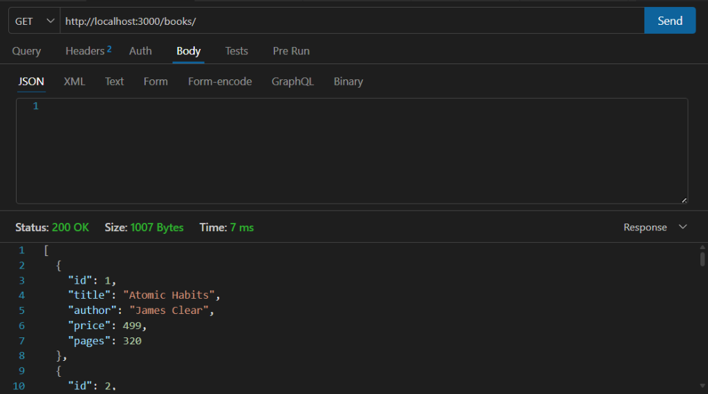
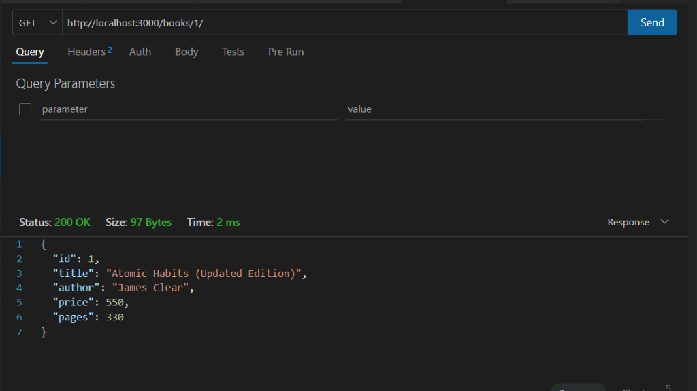
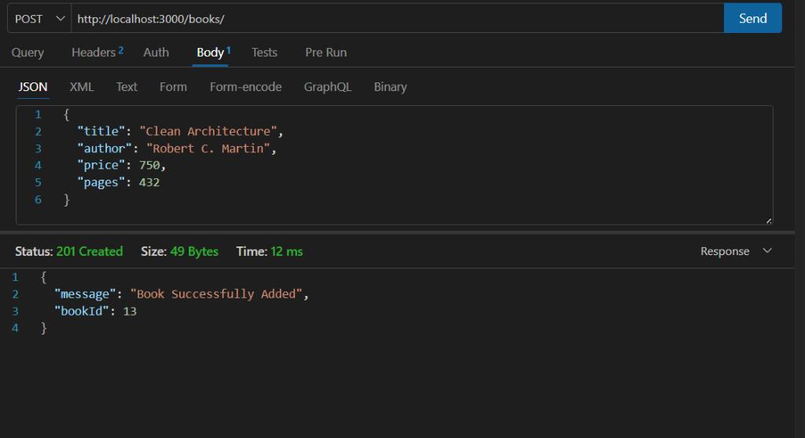
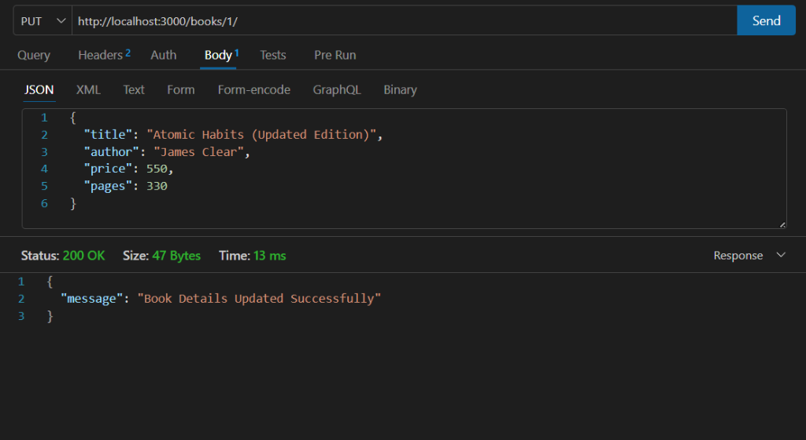
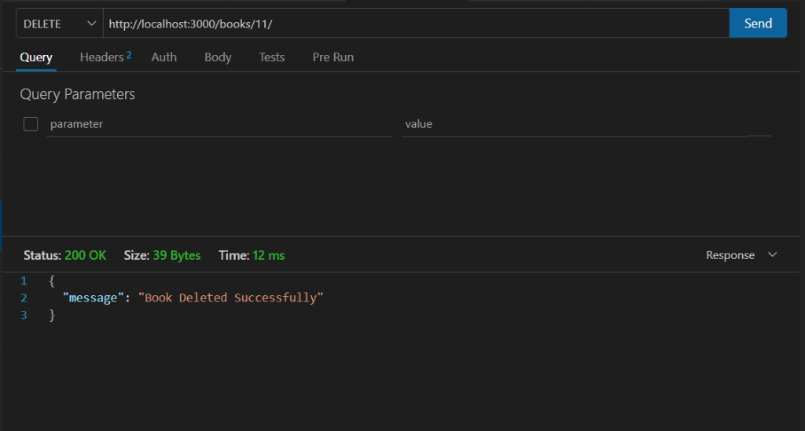

# Lab 2: SQLite database and CRUD routes

## Student Details

- **Name:** Shaik Suheal
- **Registration Number:** 252U1R9145
- **Section:** CSE-GEN-AI 2C 112
- **Course:** Backend Development Fundamentals (Year II Term II)
- **Faculty:** Joel Prashanth D
- **Institution:** Aurora
- **GitHub Repository:** [Backend_development_fundamentals_lab_02](https://github.com/shaik-creator/Backend_development_fundamentals_lab_02)

---

## Live Link

**Deployment URL:** Not deployed yet (Deployment is pending; local development and testing completed).

---

## How to Run

### 1. Installation
Navigate into the `lab-02` directory and install the project dependencies:
```bash
cd backend_fundementals/lab-02
npm install
```

### 2. Environment Variables
The application supports the following environment variables:
| Variable | Description | Default Value |
| :--- | :--- | :--- |
| `PORT` | Port number on which the Express server listens | `3000` |
| `NODE_ENV` | Application environment (`development` / `production`) | `development` |

To run on a custom port (e.g. 4000) in PowerShell:
```powershell
$env:PORT=4000; npm start
```

### 3. Database Initialization (Run Once or Reset)
Initialize and seed the SQLite database (`bookstore.db`) with 10 sample books idempotently:
```bash
npm run init-db
# or
node init-db.js
```
To reset the database back to the clean seed state at any time:
```bash
node init-db.js --reset
```

### 4. Start Commands

- **Development Mode (with auto-reload on file changes):**
  ```bash
  npm run dev
  ```
- **Standard Start:**
  ```bash
  npm start
  ```
The server will start listening at `http://localhost:3000/`.

### 5. Automated API Test Suite
With the server running, open another terminal and run all automated tests:
```bash
npm test
```

---

## Endpoints / Scripts Table

### Endpoints Table
| Method | Endpoint | Description | Request Body | Expected Status |
| :--- | :--- | :--- | :--- | :--- |
| **GET** | `/books/` | Retrieve all 10 books from database | None | `200 OK` |
| **GET** | `/books/:bookId/` | Retrieve a single book by its ID | None | `200 OK` (or `404 Not Found`, `400 Bad Request`) |
| **POST** | `/books/` | Add a new book using parameterized `INSERT` | JSON (`title`, `author`, `price`, `pages`) | `201 Created` (or `400 Bad Request`) |
| **PUT** | `/books/:bookId/` | Update an existing book using parameterized `UPDATE` | JSON (`title`, `author`, `price`, `pages`) | `200 OK` (or `404 Not Found`, `400 Bad Request`) |
| **DELETE** | `/books/:bookId/` | Delete a book by ID using parameterized `DELETE` | None | `200 OK` (or `404 Not Found`, `400 Bad Request`) |

### Available Scripts Table
| Script Command | Command Executed | Purpose |
| :--- | :--- | :--- |
| `npm start` | `node app.js` | Starts the Express server in production mode |
| `npm run dev` | `nodemon app.js` | Starts the server in development mode with nodemon auto-restart |
| `npm run init-db` | `node init-db.js` | Initializes and seeds `bookstore.db` with sample records |
| `npm test` | `node test-api.js` | Runs automated verification of all 5 CRUD routes and error cases |

---

## Screenshots

> All screenshot images are saved in the [`screenshots/`](screenshots/) directory.

### 1. GET All Books (`/books/`)
Displays all book records in JSON format with status `200 OK`.


### 2. GET Single Book (`/books/1/`)
Displays details of a single book by ID with status `200 OK`.


### 3. POST Create Book (`/books/`)
Displays response after creating a new book with status `201 Created`.


### 4. PUT Update Book (`/books/1/`)
Displays response after updating an existing book with status `200 OK`.


### 5. DELETE Book (`/books/1/`)
Displays confirmation message after deleting a book with status `200 OK`.


### 6. Error: Not Found (`/books/999/` or invalid route)
Displays `404 Not Found` response when querying a non-existent book ID.


### 7. Database Verification
Displays the formatted table of records printed in the terminal via `node init-db.js`.


---

## Viva Questions and Answers

### 1. Why do we `await` the database call?
Database operations (reading/writing to disk, executing SQL queries) are asynchronous and take a non-deterministic amount of time. In Node.js, `await` pauses execution of the async function until the returned Promise resolves or rejects, without blocking the Node.js event loop. Without `await`, the function would return synchronously before data arrives from the database, resulting in `undefined` values or race conditions.

### 2. What is SQL injection and how do placeholders (`?`) prevent it?
SQL injection is a security vulnerability where malicious SQL commands are concatenated into a SQL statement, allowing attackers to manipulate queries, access unauthorized data, or delete tables. Placeholders (`?`) use **parameterized queries** (prepared statements). The SQL query structure is pre-compiled by the database engine first, and user input is treated strictly as literal data values rather than executable code, neutralizing any injected SQL syntax.

### 3. When is PUT used instead of POST?
- **POST** is used to create a new subordinate resource. It is **non-idempotent** (sending the same POST request multiple times creates multiple duplicate records with new auto-incremented IDs).
- **PUT** is used to replace or update an existing resource at a specific URI (e.g. `/books/1`). It is **idempotent** (sending the same PUT request multiple times results in the exact same state as sending it once).

---

## Notes: Problems Faced and How You Solved Them

1. **`package.json` JSON Parse Error (`End of file expected. @ line 11`):**
   - *Problem:* Two distinct root JSON objects were pasted sequentially in `package.json`, which is invalid JSON syntax.
   - *Solution:* Merged the `dependencies`, `devDependencies`, and `scripts` into a single valid root JSON object.

2. **SQLite CLI (`sqlite3.exe`) Not Installed in Windows PATH:**
   - *Problem:* Executing `sqlite3 bookstore.db` directly in PowerShell caused `The term 'sqlite3' is not recognized`.
   - *Solution:* Implemented an automated database initialization script (`init-db.js`) using the promise-based `sqlite` and `sqlite3` Node.js packages to create the table and seed records safely without needing the external CLI.

3. **Preventing Duplicate Seed Data on Multiple Runs:**
   - *Problem:* Running `init.sql` repeatedly would insert duplicate book records every time.
   - *Solution:* Made `init-db.js` idempotent by running `SELECT COUNT(*) AS count FROM book;`. If records already exist, seed insertion is skipped. A `--reset` flag was also added to allow a clean database wipe and re-seed.

4. **Input Validation and HTTP Error Responses:**
   - *Problem:* Requests with invalid ID types (e.g. `/books/abc/`) or missing fields in POST/PUT could cause unexpected database errors or crashes.
   - *Solution:* Created validation helper functions checking for positive integer IDs and required non-empty string and positive numeric values, returning consistent `400 Bad Request` JSON responses.

5. **GitHub Remote Push Email Privacy Error (`GH007`):**
   - *Problem:* When pushing `lab-02` to GitHub, GitHub rejected the push because email privacy protection was enabled for the personal Gmail address.
   - *Solution:* Configured local repository Git author email to the GitHub private noreply address (`220653140+shaik-creator@users.noreply.github.com`), reset and re-committed the changes cleanly, allowing the push to complete successfully.
